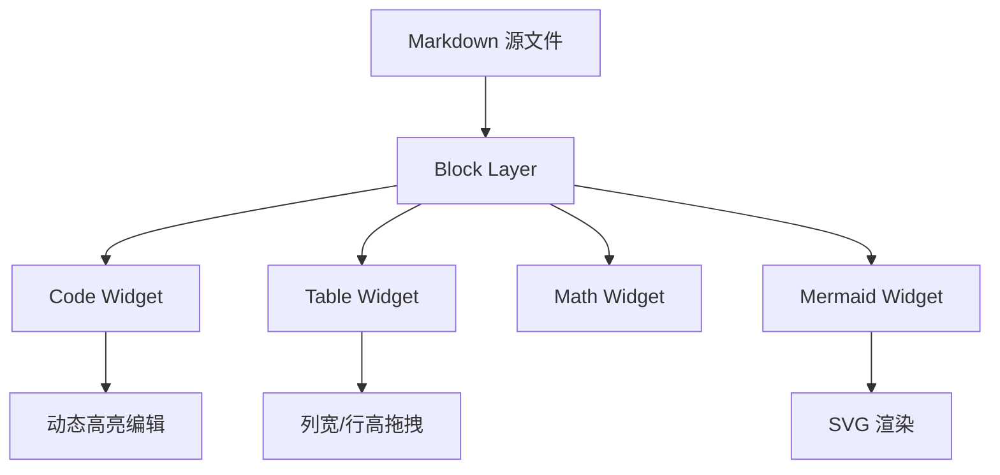
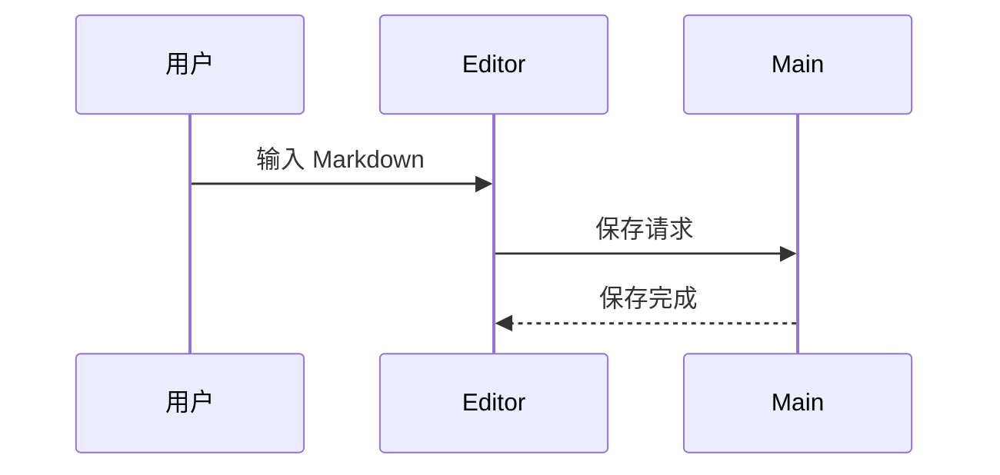

# LibrePen 复杂 Markdown 渲染样张

这是一份用于压力测试的 Markdown 文档，覆盖行内格式、块级内容、嵌套结构、表格、代码、数学、图表、脚注、图片和长文本。

[toc]

## 1. 行内格式

普通文本、**加粗**、*斜体*、***加粗斜体***、~~删除线~~、==高亮==、`inline code`、H^2^O、CO~2~、<u>下划线</u>、:sparkles:、:rocket:。

转义字符：\*不是斜体\*、\_不是下划线\_、\`不是代码\`、\[不是链接\]。

自动链接：<https://example.com>，裸链接 https://example.org/path?q=1&lang=zh。

引用式链接：[LibrePen 项目][repo]，以及 [参考文档][docs]。

[repo]: https://github.com/3588044667HZ/LibrePen
[docs]: https://commonmark.org/help/


## 2. 标题层级

### 2.1 三级标题

#### 2.2 四级标题

##### 2.3 五级标题

###### 2.4 六级标题

Setext 一级标题
================

Setext 二级标题
----------------

## 3. 列表

### 3.1 无序列表

- 第一项
- 第二项，包含 `inline code` 与 **加粗**
  - 嵌套项 A
  - 嵌套项 B
    - 更深一层
- 第三项

### 3.2 有序列表

1. 准备数据
2. 训练模型
   1. 基线模型
   2. 消融实验
3. 汇总指标

### 3.3 任务列表

- [x] 完成文件读取
- [x] 完成实时预览
- [ ] 完成表格拖拽重排
- [ ] 完成图片上传

## 4. 引用

> 一级引用：Markdown 源文件是唯一真相。
>
> > 二级引用：渲染层只负责显示，不修改源文件。
> >
> > - 引用中的列表
> > - 引用中的 `code`
>
> 回到一级引用。

> [!NOTE]
> GitHub 风格提示块；当前按普通引用渲染。

## 5. 代码

### 5.1 JavaScript

```js
import { EditorState } from '@codemirror/state'

const state = EditorState.create({
  doc: '# Hello LibrePen',
  extensions: []
})

export function countLines(text) {
  return text.split('\n').length
}
```

### 5.2 Python

```python
from pathlib import Path


def load_metrics(root: Path) -> dict:
    path = root / "metrics.json"
    if not path.exists():
        raise FileNotFoundError(path)
    return json.loads(path.read_text(encoding="utf-8"))
```

### 5.3 Bash

```bash
npm run typecheck
npm test
npm run build
```

### 5.4 JSON

```json
{
  "name": "LibrePen",
  "version": "0.2.1",
  "features": ["live-preview", "tables", "code", "math", "mermaid"],
  "enabled": true
}
```

### 5.5 CSS

```css
.markdown-body {
  max-width: 100%;
  font-family: var(--editor-font);
  line-height: 1.6;
}

.markdown-body table th {
  font-weight: 600;
}
```

## 6. 数学

行内公式：质能方程 $E = mc^2$，求和 $\sum_{i=1}^{n} i = \frac{n(n+1)}{2}$，矩阵 $\begin{bmatrix} a & b \\ c & d \end{bmatrix}$。

块级公式：

$$
\int_{-\infty}^{\infty} e^{-x^2}\,dx = \sqrt{\pi}
$$

$$
\begin{aligned}
\nabla \cdot \mathbf{E} &= \frac{\rho}{\varepsilon_0} \\
\nabla \cdot \mathbf{B} &= 0 \\
\nabla \times \mathbf{E} &= -\frac{\partial \mathbf{B}}{\partial t}
\end{aligned}
$$

## 7. Mermaid





## 8. 表格

| 实验名 | 运行命令（简） | 日期 | Accuracy | Macro-F1 | Weighted-F1 | 训练时长 | 产物路径 | 备注 |
| --- | --- | --- | --- | --- | --- | --- | --- | --- |
| ckplus_baseline | `python code/train.py --dataset ckplus --data-root data/CK+/CK+ --aug none --loss ce --out runs/ckplus_baseline` | 2026-11-15 | 0.9123 | 0.8977 | 0.9011 | 42m | runs/ckplus_baseline/ | 此前 best.pt 疑似中断，需重跑核对 |
| rafdb_baseline | `python code/train.py --dataset rafdb --data-root data/RAF-DB --aug none --loss ce --out runs/rafdb_baseline` | 2026-11-15 | 0.8834 | 0.8610 | 0.8722 | 55m | runs/rafdb_baseline/ | 标签文件到位后执行 |
| 混淆矩阵解读 | 读 metrics.json 的 confused_matrix 字段 |  | — | — | — | — | docs/成员2-相关工作与实验设置.md 末节 | CK+/RAF-DB 各一段 |

| 左对齐 | 居中 | 右对齐 | 长文本 |
| :--- | :---: | ---: | --- |
| a | b | c | 这是一段很长的单元格文本，用于测试自动换行、行高变化与列宽拖拽。 |
| `code` | **bold** | [link](https://example.com) | 包含内联格式的单元格。 |

## 9. 脚注与定义

这里有一个脚注引用[^1]，还有第二个脚注[^note]。

[^1]: 这是脚注 1 的正文。
[^note]: 这是脚注 note 的正文，支持 **加粗** 和 `code`。

术语列表（Definition List）：

Term 1
: Definition 1

Term 2
: Definition 2

## 10. HTML 与特殊内容

<div class="raw-html-demo" style="padding: 8px 0;">
  <strong>原始 HTML 块</strong>：当前编辑区按源码显示，导出时净化。
</div>

行内 HTML：<span style="color: #0969da;">蓝色文本</span>。

硬换行测试：  
第一行末尾有两个空格。  
这是下一行。

分隔线：

---

***

___

## 11. 长文本与边界

这是一段用于测试自动换行和阅读宽度的长文本。Lorem ipsum dolor sit amet, consectetur adipiscing elit, sed do eiusmod tempor incididunt ut labore et dolore magna aliqua. Ut enim ad minim veniam, quis nostrud exercitation ullamco laboris nisi ut aliquip ex ea commodo consequat。中文部分继续补充：LibrePen 采用源码优先的编辑模型，所有块级渲染都由 CodeMirror 6 的 StateField 和 Widget 完成，行内标记在光标进入时还原，离开时折叠。

一个超长路径：`F:\脑科学上机\成员2-基线与实验设置\runs\ckplus_baseline\checkpoints\best.pt`。

一个超长 URL：https://example.com/reports/2026/11/very/long/path/that/should/wrap/or/scroll/without/breaking/the/editor?query=librepen&mode=markdown

内联代码里的管道与反引号：`a | b`、`` `code` ``。

嵌套引用与代码：

> 引用里说明一段命令：
>
> ```bash
> npm run dev
> ```
>
> 然后继续解释。

## 12. 结尾

- 所有内容应保持可编辑。
- 源码模式 `Ctrl+/` 应能看到完整 Markdown。
- 表格单元格内联 Markdown、代码块内嵌动态高亮、Mermaid SVG、KaTeX、项目符号列表都应正常显示。

> 最后一段引用，用于检查滚动和焦点状态。
