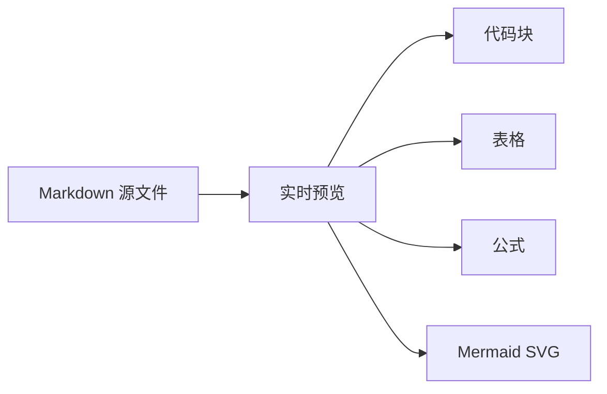
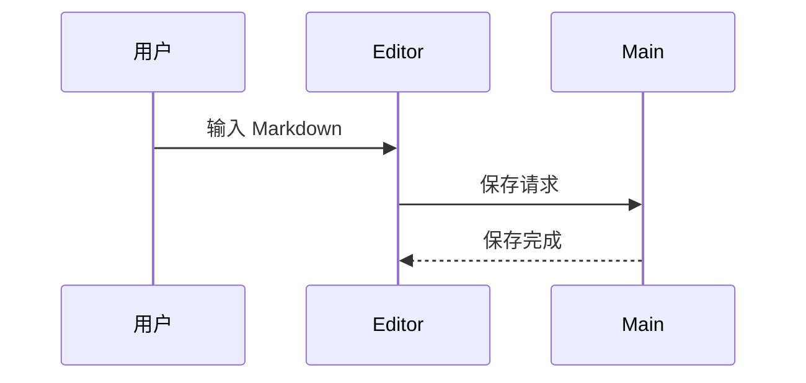

# LibrePen 样式对照样张

本文件用于与参考编辑器并排打开，对比同一份 Markdown 的排版与样式。建议将两边的编辑区宽度、字体大小调到接近；LibrePen 可在「设置 → 编辑器」调整字号和内容宽度。

> 使用说明：本文件按 LibrePen 0.2.1 的样式范围编写。代码块、表格、公式、Mermaid、TOC、Front Matter 在编辑区以块组件呈现；文末列出当前已知差异。

[toc]

## 1. 标题层级

以下依次展示 H1–H6。LibrePen 当前为所有标题添加下分割线。

一级标题（Setext H1）
====================

一级标题正文。用于观察字号、字重、行高与分割线间距。

二级标题（Setext H2）
--------------------

二级标题正文。

### 三级标题

三级标题正文。

#### 四级标题

四级标题正文。

##### 五级标题

五级标题正文。

###### 六级标题

六级标题正文。

**对照点**：字号阶梯、字重、行高、标题上下间距、分割线颜色与长度。

## 2. 正文与行内格式

普通正文：中文排版测试，English text，数字 1234567890。正文使用 Open Sans，中文回退系统字体；这是第二句，用于观察中文标点、英文单词和数字混排时的字距与行高。

- **粗体**、*斜体*、***粗斜体***
- ~~删除线~~、==高亮==、`行内代码`
- 转义字符：\*不是斜体\*、\_不是下划线\_、\`不是代码\`

嵌套行内格式：**粗体中包含 *斜体* 和 `代码`**。

内联代码中的管道与反引号：`a | b`、`` `code` ``。

## 3. 链接与图片

- 行内链接：[CommonMark 规范](https://commonmark.org/help/)
- 自动链接：<https://example.com>
- 裸链接：https://example.org/path?q=1&lang=zh
- 引用式链接：[LibrePen 项目][repo]
- 带标题的链接：[示例站点](https://example.com "示例标题")


[repo]: https://github.com/3588044667HZ/LibrePen

## 4. 列表

### 4.1 无序列表

- 第一项
- 第二项，包含 `inline code` 和 **加粗**
  - 嵌套项 A
  - 嵌套项 B
    - 更深一层
- 第三项

### 4.2 有序列表

1. 准备数据
2. 训练模型
   1. 基线模型
   2. 消融实验
3. 汇总指标

### 4.3 任务列表

- [x] 已完成任务
- [ ] 未完成任务
- [x] 包含 `code` 的 **已完成** 任务

## 5. 引用

> 一级引用：Markdown 源文件是唯一真相。
>
> > 二级引用：渲染层只负责显示，不修改源文件。
> >
> > - 引用中的列表
> > - 引用中的 `行内代码`
>
> 回到一级引用。

> **提示块测试**
>
> 这是普通引用中的多段文本，用于观察引用边框、内边距和行高。

## 6. 代码

行内代码：`npm run dev`、`const value = 1`、`` `code` ``。

### JavaScript

```js
import { EditorState } from '@codemirror/state'

const state = EditorState.create({
  doc: '# Hello LibrePen',
  extensions: []
})

export function countLines(text) {
  return text.split('\n').length
}
```

### TypeScript

```ts
interface DocumentMeta {
  path: string
  dirty: boolean
}

export function isDirty(meta: DocumentMeta): boolean {
  return meta.dirty
}
```

### Python

```python
from pathlib import Path


def load_metrics(root: Path) -> dict:
    path = root / 'metrics.json'
    if not path.exists():
        raise FileNotFoundError(path)
    return json.loads(path.read_text(encoding='utf-8'))
```

### Bash

```bash
npm run typecheck
npm test
npm run build
```

### JSON

```json
{
  "name": "LibrePen",
  "version": "0.2.1",
  "features": ["live-preview", "tables", "code", "math", "mermaid"],
  "enabled": true
}
```

### CSS

```css
.markdown-body {
  max-width: 100%;
  font-family: var(--editor-font);
  line-height: 1.6;
}

.markdown-body table th {
  font-weight: 600;
}
```

## 7. 表格

### 7.1 单元格内容

| 样式 | 示例 | 对照重点 |
| :--- | :--- | :--- |
| 标题 | H1–H6 + Setext | 字号、字重、分割线 |
| 行内 | **粗体**、*斜体*、`code` | 标记隐藏与光标还原 |
| 链接 | [示例链接](https://example.com) | 颜色与下划线 |
| 长文本 | 这是一段较长的单元格文本，用于观察自动换行、行高变化与列宽拖拽。 | 换行、行高、列宽 |
| 表格 | 本表 | 边框、表头、斑马纹 |
| 代码 | `npm run dev` | 背景、行号、语法高亮 |

### 7.2 列对齐

| 左对齐 | 居中 | 右对齐 |
| :--- | :---: | ---: |
| left | center | right |
| 左侧内容 | 居中内容 | 右侧内容 |

## 8. 数学

行内公式：$E = mc^2$，$\sum_{i=1}^{n} i = \frac{n(n+1)}{2}$，矩阵 $\begin{bmatrix} a & b \\ c & d \end{bmatrix}$。

块级公式：

$$
\int_{-\infty}^{\infty} e^{-x^2}\,dx = \sqrt{\pi}
$$

$$
\begin{aligned}
\nabla \cdot \mathbf{E} &= \frac{\rho}{\varepsilon_0} \\
\nabla \cdot \mathbf{B} &= 0 \\
\nabla \times \mathbf{E} &= -\frac{\partial \mathbf{B}}{\partial t}
\end{aligned}
$$

## 9. Mermaid 图表





## 10. 分隔线与换行

三种分隔线写法：

---

***

___

硬换行（行尾两个空格）：第一行  
第二行

普通换行（行尾无空格）：第一行
第二行

## 11. 扩展语法与已知差异

以下项目在其他 Markdown 编辑器中可能有更完整的呈现，可用于观察 LibrePen 当前差异。

### 11.1 脚注

脚注引用[^1]与第二个脚注[^note]。

[^1]: 脚注 1 的正文。
[^note]: 脚注 note 的正文，支持 **加粗** 与 `code`。

### 11.2 定义列表

术语 1
: 定义 1

术语 2
: 定义 2

### 11.3 GitHub 提示块

> [!NOTE]
> 这是一个 GitHub 风格提示块，LibrePen 当前按普通引用显示。

### 11.4 原始 HTML

<div style="padding: 8px; border: 1px solid #ddd;">
  <strong>原始 HTML 块</strong>
</div>

行内 HTML：<span style="color: #0969da;">蓝色文本</span>

### 11.5 上标、下标与下划线

- 上标：H^2^O
- 下标：CO~2~
- 下划线：<u>带下划线的文本</u>

### 11.6 Emoji

`:sparkles:` `:rocket:` `:smile:`

### 11.7 引用中的代码块

> 引用中的代码块：
>
> ```bash
> npm run dev
> ```

## 12. 对照检查表

| 样式项 | 重点观察 |
| --- | --- |
| 正文 | 字体、字号、行高、颜色、中英文混排 |
| 标题 | 字号阶梯、字重、上下间距、下分割线 |
| 行内格式 | 粗体、斜体、删除线、高亮、行内代码、上下标、下划线 |
| 链接与图片 | 链接颜色、下划线、图片圆角与最大宽度 |
| 列表 | 项目符号、缩进、嵌套层级、任务复选框 |
| 引用 | 左边框、文字颜色、内外边距、嵌套引用 |
| 代码 | 字体、背景、行号、语言高亮、内联编辑状态 |
| 表格 | 边框、表头底色、斑马纹、单元格内边距、列宽 |
| 数学 | KaTeX 字号、行内公式基线、块级公式间距 |
| Mermaid | SVG 尺寸、连线样式、文字清晰度 |
| 分隔线 | 颜色、粗细、上下间距 |
